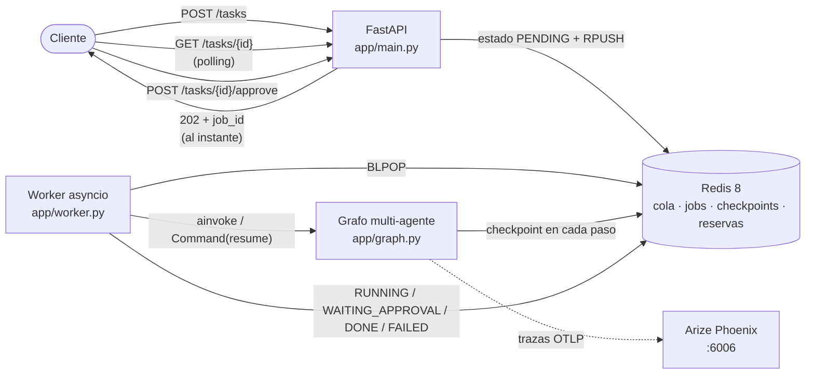
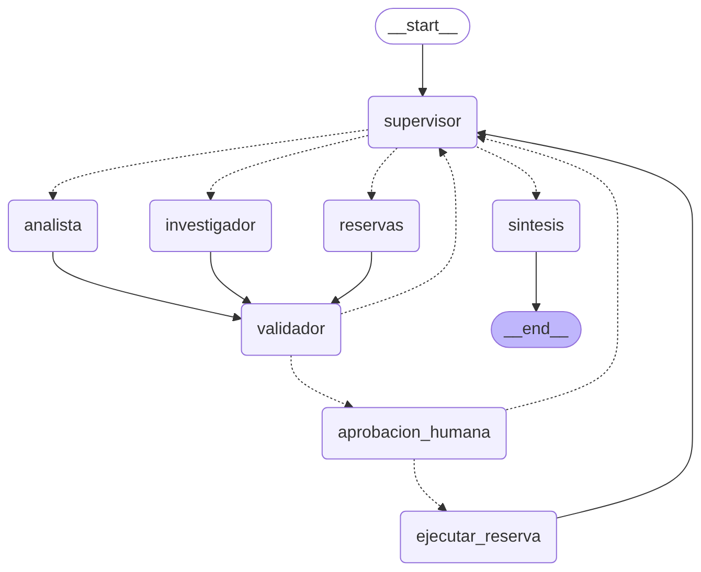

# Pre-Entrega 7 — API de producción y monitoreo activo

**AI Engineering — Coderhouse**

API REST asíncrona (**FastAPI**) que expone el orquestador multi-agente de la
Pre-Entrega 6 (análisis técnico de autos **Volkswagen**), con:

- **endpoints que no bloquean**: reciben la tarea, la encolan en Redis y devuelven un `job_id` al instante;
- **Redis** como cola, como registro del estado de cada job y como **checkpointer de LangGraph** (`AsyncRedisSaver`);
- **observabilidad** con **Arize Phoenix** (OpenInference): una traza por ejecución, con costo y latencia;
- **Human-in-the-loop**: reservar una unidad del stock (una acción con efecto secundario) **pausa el grafo** hasta que una persona la aprueba;
- **prueba de carga** de 5 peticiones concurrentes, con costo por ejecución y latencia p95 leídos de Phoenix.

## Guía para la evaluación

Dónde está la evidencia de cada criterio de la rúbrica:

| Criterio (peso) | Qué se demuestra | Dónde |
|---|---|---|
| **Orquestación Asíncrona y API** (30 %) | `POST /tasks` encola y devuelve el `job_id` sin bloquear el event loop; un worker asíncrono corre el grafo | Sección 4 · `app/main.py` · `app/worker.py` · test `test_cinco_jobs_concurrentes_no_se_bloquean_entre_si` |
| **Persistencia con Redis** (25 %) | Estado del job en Redis (PENDING / RUNNING / WAITING_APPROVAL / DONE / **FAILED**), checkpoints de LangGraph en Redis, recuperación tras un reinicio | Sección 5 · `app/jobs.py` · `app/graph.py` (`checkpointer_redis`) · tests `test_una_excepcion_no_controlada_deja_el_job_en_failed` y `test_redis_real_...` |
| **Observabilidad** (25 %) | Trazas de cada nodo en Phoenix; costo por ejecución y latencia p95 de las 5 peticiones concurrentes | Sección 7 · `app/observability.py` · `orquestador/trazado.py` · capturas en `/screenshots` (sección 10) · `scripts/prueba_carga.py` |
| **Human-in-the-loop** (15 %) | Nodo que pausa el grafo con `interrupt()` hasta recibir la aprobación externa por `POST /tasks/{id}/approve` | Sección 6 · `app/hitl.py` · `scripts/demo_hitl.py` · tests `test_reserva_pausa_hasta_la_aprobacion_...` |
| **Documentación y estructura** (5 %) | Cómo levantar Redis y la API, cómo lanzar las 5 peticiones, `requirements.txt` y Docker Compose | Secciones 8 y 9 · `requirements.txt` · `docker-compose.yml` · `.env.example` |

## 1. Resumen

| Aspecto | Detalle |
|---|---|
| API | FastAPI: `POST /tasks`, `GET /tasks/{id}`, `GET /tasks`, `POST /tasks/{id}/approve`, `GET /health` |
| Worker | Tareas asyncio dentro de la API (`WORKERS=5`) o proceso aparte (`python -m app.worker`) |
| Redis 8 | Cola (`RPUSH`/`BLPOP`), estado de los jobs (hash + historial), checkpoints de LangGraph (`AsyncRedisSaver`), reservas (script Lua atómico) |
| Observabilidad | Arize Phoenix local (Docker) vía OpenInference: nodos, agentes, LLM, herramientas, tokens, costo y latencia |
| HITL | Reservar una unidad pausa el grafo (`interrupt`) hasta la aprobación humana; se reanuda con `Command(resume=...)` |
| Orquestador | El de la Pre-Entrega 6 (Supervisor + Investigador + Analista + Validador + Síntesis) más un **Gestor de reservas** |
| LLM | `gpt-4o-mini` (OpenAI) por defecto; también Anthropic, Gemini u Ollama por `.env` |
| Tests | 37 tests con `pytest`, sin API key ni Docker (Redis falso); 2 de integración con Redis 8 real |

## 2. Arquitectura



El patrón es el de la clase: **FastAPI (recepcionista) → Redis (buzón) →
Worker (especialista)**. La API nunca corre el grafo dentro del request: un flujo
de agentes tarda decenas de segundos, y mantener la conexión abierta todo ese
tiempo se corta por timeout y satura el servidor.

### Estructura del repositorio

```
api-orquestador-vw/
├── app/
│   ├── main.py            # FastAPI: POST /tasks encola y devuelve job_id · GET /tasks/{id} → estado
│   ├── graph.py           # orquestador del M6 + rama de reservas + checkpointer de Redis (AsyncRedisSaver)
│   ├── worker.py          # corre los jobs en segundo plano: PENDING/RUNNING/WAITING_APPROVAL/DONE/FAILED
│   ├── jobs.py            # estado de los jobs y cola en Redis
│   ├── observability.py   # Phoenix (OpenInference) + span raíz de cada job
│   ├── hitl.py            # nodo de aprobación humana (interrupt) + POST /tasks/{id}/approve
│   └── traza.py           # ejecución con log de decisiones (de la Pre-Entrega 6, la usan los tests)
├── orquestador/           # el sistema multi-agente de la Pre-Entrega 6
│   ├── agents/            # supervisor, investigador, analista, gestor de reservas, síntesis
│   ├── tools/             # catálogo, búsqueda en fichas, calculadora y reservar_unidad (efecto secundario)
│   ├── state.py · validation.py · prompts.py · llm.py · config.py
│   └── trazado.py         # decorador @agente para trazar cada agente
├── scripts/
│   ├── prueba_carga.py    # 5 peticiones concurrentes + costo y p95 desde Phoenix
│   └── demo_hitl.py       # pide una reserva, muestra el pedido de aprobación y lo resuelve
├── tests/                 # test_orquestador.py (M6) + test_api.py (API, worker, Redis, HITL)
├── screenshots/           # capturas del dashboard de Phoenix (evidencia de observabilidad)
├── evidencia/             # reportes JSON de la prueba de carga
├── data/                  # fichas técnicas de los 7 modelos (Markdown)
├── docs/grafo.png         # el grafo, generado del grafo compilado
├── docker-compose.yml     # Redis 8 + Phoenix (+ la API, opcional)
├── Dockerfile · requirements.txt · .env.example
└── README.md
```

## 3. El grafo



*(Generado del grafo compilado con `get_graph().draw_mermaid()`; el código Mermaid está en `docs/grafo.mmd`.)*

Es el grafo jerárquico de la Pre-Entrega 6 (las aristas punteadas son
condicionales), con una rama nueva para la acción crítica:

| Nodo | Qué hace | Nuevo en la 7 |
|---|---|---|
| `supervisor` | Reglas determinísticas + LLM con salida estructurada: decide quién sigue | Conoce al gestor de reservas |
| `investigador` / `analista` | Agentes con herramientas (catálogo, fichas, calculadora) | — |
| `reservas` | **Gestor de reservas**: PREPARA la reserva (versión, sucursal, cliente) con `consultar_catalogo`, que es de solo lectura | ✔ |
| `validador` | Código determinístico: procedencia de datos, recálculo de cuentas y **validación de la reserva contra el catálogo** | Valida reservas |
| `aprobacion_humana` | `interrupt()`: **pausa el grafo** hasta la decisión humana | ✔ |
| `ejecutar_reserva` | Ejecuta `reservar_unidad` (efecto secundario), **solo** después de la aprobación | ✔ |
| `sintesis` | Redacta la respuesta final (incluye la reserva o su rechazo) | — |

## 4. API asíncrona

| Método | Ruta | Respuesta |
|---|---|---|
| `POST` | `/tasks` | **202** `{"job_id", "estado": "PENDING", "consultar"}`: solo escribe en Redis, en milisegundos |
| `GET` | `/tasks/{job_id}` | Estado, historial de estados, resultado (respuesta + quién decidió qué y por qué), error o pedido de aprobación. **404** si no existe |
| `GET` | `/tasks` | Últimos jobs con su latencia (para revisar una prueba de carga) |
| `POST` | `/tasks/{job_id}/approve` | **202** con la decisión registrada; **409** si el job no espera aprobación (o ya se aprobó) |
| `GET` | `/health` | Redis, largo de la cola y workers activos |

La documentación interactiva queda en `http://localhost:8000/docs`.

**Por qué no se bloquea el event loop** (error común de la consigna):

- Los endpoints solo hacen operaciones en Redis con el cliente **async** (`redis.asyncio`): nunca corren el grafo ni llaman al LLM.
- El worker es async de punta a punta: `grafo.ainvoke`, LLM async, herramientas async y `AsyncRedisSaver`. No hay llamadas sincrónicas a bases de datos ni al LLM dentro del event loop, así que no hace falta `run_in_threadpool`.
- Los 5 workers son **tareas asyncio**, no hilos: mientras un job espera al modelo, el event loop atiende a los demás y a los requests. En la corrida real con `gpt-4o-mini`, los 5 POST concurrentes respondieron en **288 ms en total**, y los 5 jobs (de 12,2 a 17,2 s cada uno) terminaron en **17,6 s**: en serie hubieran sumado 70,5 s (sección 10).

**Worker en el mismo proceso o aparte.** Por defecto (`WORKER_EN_PROCESO=true`)
la API lanza los workers en su event loop al arrancar (`lifespan`). Con
`WORKER_EN_PROCESO=false` la API solo encola, y los jobs los procesa un proceso
separado (`python -m app.worker`), que escala por su cuenta.

## 5. Persistencia con Redis

### Claves

| Clave | Tipo | Contenido |
|---|---|---|
| `vw:job:{id}` | hash | estado, tarea, fechas, duración, resultado, error, pedido de aprobación, decisión humana |
| `vw:job:{id}:historial` | lista | cada cambio de estado, cuándo y por qué |
| `vw:cola` | lista | la cola: `RPUSH` para encolar, `BLPOP` para tomar |
| `vw:jobs` | sorted set | todos los jobs por fecha |
| `checkpoint:*`, `checkpoint_write:*` | JSON | checkpoints de LangGraph (`AsyncRedisSaver`), por `thread_id = job_id` |
| `vw:reserva:{job_id}`, `vw:reservas:*` | string / contador | las reservas y las unidades ya reservadas por versión y sucursal |

### Ciclo de vida de un job

```
PENDING ──> RUNNING ──> DONE
                   ├──> FAILED              (excepción no controlada o timeout)
                   └──> WAITING_APPROVAL ──(approve)──> PENDING ──> RUNNING ──> DONE
```

- **El estado se guarda antes de encolar** (error común de la clase "no persistir el estado inicial"): `crear()` escribe el job y lo encola en una sola transacción `MULTI/EXEC`. El cliente nunca consulta un job que todavía no existe.
- **FAILED ante cualquier excepción** (error común "ignorar el manejo de errores en background tasks"): el worker captura todo error del grafo, del LLM o de Redis, y también el timeout (`TIMEOUT_JOB_S`), y deja el job en FAILED con el error. El cliente que hace polling nunca queda esperando para siempre. Se puede probar con `{"simulacion": {"romper_grafo": true}}`.
- **Aprobación atómica:** aprobar es "leer el estado y, si espera aprobación, cambiarlo y encolar la reanudación". Lo hace un script Lua de una sola vez, así dos aprobaciones simultáneas no reanudan el grafo dos veces (la segunda recibe 409).
- **Jobs interrumpidos:** si el proceso se corta con un job en RUNNING (reinicio, `kill -9`), al volver a arrancar el worker lo encola con la acción "continuar" y el grafo **retoma desde su último checkpoint en Redis**, sin repetir los pasos que ya había hecho. Esto se probó cortando la API con `kill -9` a mitad de un job.

### Checkpoints de LangGraph en Redis

`app/graph.py` compila el grafo con `AsyncRedisSaver` (paquete
`langgraph-checkpoint-redis`). Necesita **Redis 8**, que trae los módulos JSON
y Search; por eso el compose usa `redis:8` y no un Redis 7. El estado del grafo
se guarda en cada paso bajo `thread_id = job_id`: eso es lo que permite pausar,
reiniciar el proceso y reanudar.

## 6. Human-in-the-loop

**Qué es crítico.** Ejecutar una herramienta con **efecto secundario**:
`reservar_unidad` compromete una unidad del stock real de una sucursal; si sale
mal, otro cliente se queda sin el auto. Está registrada en
`ACCIONES_CRITICAS` (`app/hitl.py`). Las consultas (catálogo, fichas,
cálculos) no pausan nada: aplicar HITL a todo eliminaría la ventaja de
automatizar.

**Cómo se garantiza la pausa** (no depende de que el LLM "se acuerde"):

1. El **Gestor de reservas** solo **prepara** la reserva: su única herramienta, `consultar_catalogo`, es de solo lectura. `reservar_unidad` no está en la lista de ningún agente.
2. La propuesta pasa por el **validador** contra el catálogo (versión real, sucursal real, con stock): el humano decide sobre una reserva posible, no sobre un ID alucinado.
3. `ejecutar_reserva` **solo es alcanzable desde `aprobacion_humana`**: es una propiedad de las aristas del grafo, no de un prompt. Si el revisor rechaza, una **regla** del supervisor finaliza sin tocar el stock, y una **guarda** impide que el LLM vuelva a pedir una reserva ya resuelta.
4. `aprobacion_humana` llama a **`interrupt()`**: el grafo se detiene y su estado queda en Redis. El proceso no queda esperando en memoria: puede pasar una hora, o reiniciarse la API, y la reserva sigue en pausa.
5. `POST /tasks/{id}/approve` guarda la decisión y encola la reanudación; el worker retoma **el mismo hilo** con `Command(resume=decision)`.

Lo que ve el revisor en `GET /tasks/{id}` mientras el job está en `WAITING_APPROVAL`:

```json
{
  "estado": "WAITING_APPROVAL",
  "aprobacion": {
    "accion": "reservar_unidad",
    "motivo": "Efecto secundario: compromete una unidad del stock real de la sucursal.",
    "pregunta": "¿Aprobás reservar 1 unidad de Saveiro Extreme cabina doble en la sucursal Córdoba para Juan Pérez?",
    "propuesta": {"version_id": "SAVEIRO-EXTREME-CD", "sucursal": "Córdoba", "cliente": "Juan Pérez", "...": "..."},
    "stock_en_catalogo": 2
  },
  "siguiente_paso": "POST /tasks/{job_id}/approve con la decisión del revisor"
}
```

Y la decisión: `POST /tasks/{id}/approve` con `{"aprobado": true, "revisor": "Damián", "comentario": "seña recibida"}`.

**La reserva es atómica e idempotente** (script Lua en Redis, `orquestador/tools/reservas.py`):

- **Stock:** el catálogo dice cuántas unidades hay; Redis cuenta cuántas se reservaron. Con 5 pedidos simultáneos por la última unidad, se reserva una sola (hay un test con Redis real).
- **Idempotencia:** la clave es el `job_id`. Si el nodo se re-ejecuta para el mismo job, devuelve la reserva existente en vez de descontar stock otra vez.

**Detalle de la clase:** al reanudar, el nodo con `interrupt()` se vuelve a
ejecutar desde el principio. Por eso `aprobacion_humana` no tiene efectos antes
del `interrupt()`; la acción con efectos vive en el nodo siguiente.

**Prueba de reinicio** (el "desafío" de los apuntes): pedir una reserva,
esperar `WAITING_APPROVAL`, cortar la API, volver a levantarla y recién ahí
aprobar. El job sigue en pausa y la reserva se confirma. Se probó así:

```
PENDING           job creado y encolado
RUNNING           iniciar (worker-5)
WAITING_APPROVAL  ¿Aprobás reservar 1 unidad de Saveiro Extreme cabina doble en la sucursal Córdoba para Juan Pérez?
                  ... API detenida y vuelta a levantar ...
PENDING           decisión humana: aprobado por Damián; reanudación encolada
RUNNING           reanudar (worker-1)
DONE              respuesta lista   → Reserva R-49500B7E confirmada
```

## 7. Observabilidad con Arize Phoenix

Se eligió **Phoenix** porque corre local en Docker (los datos no salen de la
máquina), es el que usa el ejercicio guiado del módulo, calcula el costo solo
con los tokens de cada llamada y su dashboard grafica la latencia **p95** (los
gráficos personalizados de LangSmith ofrecen solo p50 y p99).

**Qué se instrumenta** (`app/observability.py`):

- `phoenix.otel.register()` + `LangChainInstrumentor` (OpenInference): cada nodo del grafo, cada llamada al modelo (con tokens de entrada y salida) y cada herramienta quedan como spans.
- El **decorador `@agente`** (`orquestador/trazado.py`) envuelve cada función de agente que llama al LLM en un Runnable llamado `agente_<nombre>`, que Phoenix muestra como **AGENT** con sus llamadas al modelo y herramientas adentro.
- Un **span raíz por ejecución** (`orquestador`), con `session.id = job_id`, la respuesta como salida y metadata: `job_id`, LLM usado, **versión y huella de los prompts** (mejor práctica de la clase: la versión del prompt va como etiqueta en cada traza).

Cada traza en Phoenix se lee así:

```
orquestador (AGENT, raíz)                       ← una traza por ejecución del job
└── LangGraph
    ├── supervisor (nodo)
    │   └── agente_supervisor (AGENT) → ChatOpenAI (LLM: tokens, costo, latencia)
    ├── investigador (nodo)
    │   └── agente_investigador (AGENT) → ChatOpenAI → consultar_catalogo (TOOL) → ChatOpenAI
    ├── validador (nodo, sin LLM)
    ├── analista (nodo) → agente_analista (AGENT) → ChatOpenAI → calculadora (TOOL)
    ├── reservas → validador → aprobacion_humana → ejecutar_reserva → reservar_unidad (TOOL)
    └── sintesis (nodo) → agente_sintesis (AGENT) → ChatOpenAI
```

Un job con aprobación humana genera **dos trazas** (antes y después de la
pausa) con el mismo `session.id`: en la pestaña **Sessions** se ven juntas.

## 8. Cómo levantar todo

Requisitos: **Python 3.12**, **Docker Desktop** y una API key de OpenAI.

```bash
# 1. Redis 8 + Phoenix
docker compose up -d
docker compose ps                     # vw-redis (healthy) y vw-phoenix (running)

# 2. Entorno de Python
py -3.12 -m venv venv
source venv/Scripts/activate          # Git Bash en Windows (Linux/Mac: source venv/bin/activate)
python --version                      # tiene que decir 3.12.x
python -m pip install -r requirements.txt

# 3. Configuración
cp .env.example .env                  # y completar OPENAI_API_KEY

# 4. La API (con los 5 workers adentro)
uvicorn app.main:app --port 8000
```

Comprobaciones:

- `http://localhost:8000/health` → `{"estado": "ok", "redis": "ok", ...}`
- `http://localhost:8000/docs` → la documentación interactiva de la API
- `http://localhost:6006` → Phoenix (el proyecto `orquestador-vw` aparece con la primera traza)

Una consulta a mano, desde otra terminal:

```bash
curl -X POST localhost:8000/tasks -H "Content-Type: application/json" \
     -d '{"tarea": "Cuantos CV mas tiene el Virtus Exclusive que el Tera High?"}'
curl localhost:8000/tasks/<job_id>
```

> En Git Bash (Windows), `curl` manda las tildes y los signos `¿` en la codificación
> de Windows, no en UTF-8, y la API responde `There was an error parsing the body`.
> Por eso el ejemplo va sin tildes. Los scripts de `scripts/` no tienen este problema:
> mandan UTF-8 siempre. También se puede usar la página `/docs`.

Para probar el estado FAILED a mano:

```bash
curl -X POST localhost:8000/tasks -H "Content-Type: application/json" \
     -d '{"tarea": "Cuanta potencia tiene el Tera?", "simulacion": {"romper_grafo": true}}'
```

**Variantes:**

- Worker en un proceso aparte: `WORKER_EN_PROCESO=false` en el `.env`, y en otra terminal `python -m app.worker`.
- Todo en Docker: `docker compose --profile api up -d --build` (la API toma la configuración del `.env`).
- Volver a llenar el stock de reservas para repetir la demo: `docker compose exec redis sh -c "redis-cli --scan --pattern 'vw:reserva*' | xargs -r redis-cli del"`.

## 9. Prueba de carga: 5 peticiones concurrentes

Con la API levantada, en otra terminal (con el venv activado):

```bash
python scripts/prueba_carga.py --limpiar
```

1. `--limpiar` vacía antes el proyecto en Phoenix (error a evitar de los apuntes: "mezclar datos" de pruebas anteriores distorsiona el p95).
2. Envía las 5 consultas **a la vez** (`asyncio.gather`) y mide cuánto tarda cada POST.
3. Hace polling de los 5 jobs y calcula la latencia de punta a punta (p50 y p95) desde los tiempos que guarda la API.
4. Le pide a Phoenix (API GraphQL) el **costo de cada ejecución** y la **latencia p95** de las trazas de esa ventana de tiempo. Espera a que llegue el span raíz de cada traza: el exportador manda los spans en lotes, y leer antes da latencias incompletas.
5. Muestra el **desglose por agente**: llamadas al LLM, tokens, costo, y qué parte del tiempo es espera del modelo (red/API) y qué parte procesamiento propio.
6. Guarda todo en `evidencia/prueba_carga_<fecha>.json`.

Para la demo de aprobación humana: `python scripts/demo_hitl.py` (pregunta si aprobás), o `--aprobar` / `--rechazar --comentario "..."`.

## 10. Capturas del dashboard (`/screenshots`)

El orden importa: **primero** la prueba de carga con `--limpiar`, y **recién
después** las demos de HITL y de falla. Así el p95 y el costo de la prueba de
carga no se mezclan con otras trazas.

En Phoenix (`http://localhost:6006` → proyecto **orquestador-vw**), con el
rango de tiempo **Last 15 Min** (arriba a la derecha):

| Archivo | Qué capturar | Dónde |
|---|---|---|
| `01_trazas.png` | Las 5 trazas de la prueba de carga, con latencia, tokens y costo | Pestaña **Traces** (las columnas `latency`, `total tokens` y `total cost` están a la derecha) |
| `02_jerarquia_de_spans.png` | Una traza abierta: nodo → agente → herramienta → modelo | Clic en una traza de la pestaña Traces |
| `03_costo_por_ejecucion.png` | El costo exacto de una ejecución | En la traza abierta, **pasar el mouse sobre "Total Cost"**: muestra el costo en USD y el desglose entrada/salida (sin el mouse, Phoenix redondea a "<$0.01") |
| `04_latencia_p95.png` | La latencia p95 de la corrida | Pestaña **Metrics**, gráfico **Trace latency**: **pasar el mouse sobre el punto** muestra p50, p75, p90, **p95** y p99 |
| `05_costo_total.png` | El costo de la corrida | Pestaña **Metrics**, gráfico **Cost** (pasar el mouse sobre la barra) |
| `06_hitl_sesion.png` | Un job con aprobación humana: dos trazas en la misma sesión | Pestaña **Sessions** (después de `scripts/demo_hitl.py`) |
| `07_job_failed.png` | Una ejecución fallida registrada como error | Pestaña Traces: la traza en rojo del `curl` de la sección 8 con `{"simulacion": {"romper_grafo": true}}` |

### Resultados de la corrida real

Corrida de `scripts/prueba_carga.py --limpiar` con `gpt-4o-mini` (temperatura 0),
prompts `v4` y 5 workers, el 19/10/2026 a las 12:13. Es la corrida de las
capturas de `/screenshots`; el reporte completo es
`evidencia/prueba_carga_20261019_121339.json`.

| # | Consulta | Respuesta | Latencia | Costo (USD) | Tokens |
|---|---|---|---|---|---|
| 1 | Virtus Exclusive vs. Tera High + unidades en Palermo | 49 CV y 80 Nm más; 3 unidades | 17,2 s | 0,001589 | 8.401 |
| 2 | Latin NCAP Tera vs. Nivus (puntos porcentuales) | 2,59 puntos porcentuales | 13,4 s | 0,001717 | 9.768 |
| 3 | Torque Taos vs. Nivus Sense | 80 Nm más | 15,3 s | 0,001234 | 6.901 |
| 4 | % de potencia Vento GLI vs. Polo Highline | 132,32 % más | 12,5 s | 0,001281 | 7.142 |
| 5 | Unidades de Saveiro en Córdoba | 8 unidades | 12,2 s | 0,001288 | 7.149 |

| Métrica | Valor |
|---|---|
| Tiempo de los 5 POST concurrentes | 288 ms en total (la API encola y no espera al grafo) |
| Tiempo total de la prueba | 17,6 s (en serie: 70,5 s de ejecución sumada → 4 veces más rápido) |
| **Latencia p95** (Phoenix, trazas de la prueba) | **16,8 s** (p50: 13,4 s) |
| **Costo por ejecución** (Phoenix) | **USD 0,0014 promedio** (entre 0,0012 y 0,0017); USD 0,0071 las 5 |
| Tokens | 39.361 en total (~7.900 por ejecución) |

### Lectura del dashboard

Desglose por agente de las 5 ejecuciones (spans de Phoenix, calculado por el script):

| Agente | Llamadas al LLM | Tokens | Costo (USD) | Tiempo | Tiempo esperando al LLM |
|---|---|---|---|---|---|
| `agente_investigador` | 10 | 15.253 (39 %) | 0,00269 | 26,6 s | 26,3 s |
| `agente_supervisor` | 15 | 13.478 (34 %) | 0,00240 | 22,7 s | 22,5 s |
| `agente_analista` | 10 | 8.486 (22 %) | 0,00155 | 13,6 s | 13,4 s |
| `agente_sintesis` | 5 | 2.144 (5 %) | 0,00047 | 7,1 s | 7,0 s |

- **Dónde se concentra la latencia: en la espera del LLM.** El 98 % del tiempo
  de las trazas es la llamada al modelo (red + API de OpenAI). El procesamiento
  propio (herramientas, validador, Redis, orquestación) es el 2 %: las
  herramientas y el validador tardan milisegundos. Optimizar el código propio
  no movería la latencia; reducir llamadas o tokens del LLM, sí.
- **El nodo que más consume es el investigador**, en tokens (39 %) y en tiempo
  (~38 % de cada ejecución: 5,3 s de ~14 s en promedio). La salida de sus
  herramientas entra completa al contexto del modelo: el catálogo devuelve
  todas las versiones del modelo con el stock de las 4 sucursales, y la
  búsqueda devuelve fragmentos de las fichas.
- **El supervisor es el segundo** (34 % de los tokens, ~32 % del tiempo): no
  por llamadas grandes, sino porque se lo llama 3 veces por job (investigar →
  analizar → finalizar).
- **El p95 lo marca la consulta 1** (17,2 s), la única que pide dos cosas
  distintas (diferencias técnicas y stock), con más datos para buscar y más
  cálculos.
- **La concurrencia no degrada la latencia:** cada job tardó lo que tardaría
  solo (12–17 s), y los 5 juntos, 17,6 s: los workers async esperan al LLM en
  paralelo sin bloquearse.
- **Los tokens son estables entre corridas; la latencia no.** En una corrida
  anterior con las mismas 5 consultas, los tokens por agente fueron casi
  idénticos (investigador 15.238, supervisor 13.436), pero el nodo más lento
  fue el supervisor (28,8 s contra 18,1 s del investigador). La latencia de la
  API de OpenAI varía de una corrida a otra; los tokens dependen de lo que
  hace el sistema. Por eso las mejoras conviene medirlas en tokens y en
  cantidad de llamadas.

**Observaciones de eficiencia** (cómo reducir costo y latencia):

1. **Achicar la salida del catálogo.** Si `consultar_catalogo` aceptara la
   versión o la sucursal y devolviera solo eso, bajarían los tokens de entrada
   del investigador, el agente que más consume.
2. **Finalizar por regla en vez de por LLM.** La tercera llamada al supervisor
   casi siempre decide FINALIZAR. Una regla determinística ("investigación y
   análisis validados y la tarea no pide nada más") ahorraría 1 de cada 3
   llamadas al supervisor: ~1,5 s por job (~11 % de la latencia) sin tocar la
   calidad, porque la síntesis igual usa solo lo validado.
3. **El costo ya es bajo:** USD 0,0014 por consulta con `gpt-4o-mini`; 1.000
   consultas por día serían ~USD 1,40.

## 11. Tests

```bash
python -m pytest -v        # 37 tests, sin API key
```

- `tests/test_orquestador.py` (22, de la Pre-Entrega 6): delegación, validación, reparación, escalado y límites del orquestador.
- `tests/test_api.py` (15): la API, el worker, los estados en Redis y el HITL. Usan **fakeredis** (Redis falso con soporte de scripts Lua) y los agentes falsos de la Pre-Entrega 6, así que no necesitan Docker ni API key. Verifican:
  - que `POST /tasks` responde al instante y deja el estado **antes** de encolar;
  - DONE con la traza de decisiones; **FAILED** ante una excepción no controlada y ante un **timeout**;
  - que **5 jobs concurrentes** no se bloquean entre sí (terminan en el tiempo de uno, no de cinco);
  - que un job interrumpido se **retoma desde el último checkpoint**;
  - la **pausa HITL** hasta la aprobación, el rechazo sin tocar el stock, la aprobación doble (409) y la guarda que impide repetir una reserva;
  - la validación de la propuesta contra el catálogo, y la idempotencia y el control de stock de `reservar_unidad`.
- Dos tests de **integración con Redis 8 real** (se saltean solos si no hay un Redis levantado): la pausa que sobrevive a un reinicio con `AsyncRedisSaver`, y 5 reservas simultáneas por la última unidad.

## 12. Errores comunes evitados

| Error de la consigna / de los apuntes | Cómo se evita |
|---|---|
| Bloquear el event loop | Endpoints que solo usan Redis async; worker async de punta a punta; workers como tareas asyncio |
| Ignorar errores en background tasks | El worker captura toda excepción y el timeout → FAILED con el error |
| No persistir el estado inicial | El job se guarda y se encola en una sola transacción, en ese orden |
| Ejecutar IA en el endpoint | La API solo encola; el grafo corre en el worker |
| Efectos antes del `interrupt()` | `aprobacion_humana` no tiene efectos; la reserva está en el nodo siguiente |
| `MemorySaver` en producción | `AsyncRedisSaver`: la pausa sobrevive a un reinicio |
| Instrumentar demasiado tarde | Phoenix se inicializa al arrancar la API o el worker, antes de crear los agentes |
| Ignorar las versiones de los prompts | `prompts_version` y `prompts_huella` como metadata y etiqueta de cada traza |
| Mezclar datos en Phoenix | `scripts/prueba_carga.py --limpiar` vacía el proyecto antes de medir |

## 13. Hallazgos durante el desarrollo

Problemas reales que aparecieron al probar contra **Redis 8 y Phoenix de
verdad**, y que no se veían con dobles de prueba:

| Problema | Causa | Corrección |
|---|---|---|
| Al reanudar después de un reinicio, `'dict' object has no attribute 'version_id'` | El checkpointer de Redis guarda los modelos Pydantic como JSON y, si no se declaran, los devuelve como diccionarios. Con el checkpointer en memoria no pasaba | `checkpointer_redis()` declara los tipos del estado en el serializador. Test de regresión con Redis real |
| El p95 de Phoenix contaba 31 trazas en vez de 5, con p50 = 0 s | Las versiones nuevas de FastAPI generan una traza por cada request HTTP si hay un TracerProvider global: los ~5 ms de cada `GET` del polling se mezclaban con los jobs | Se apaga la telemetría HTTP de FastAPI (compatible con versiones que no la tienen) |
| Phoenix daba 6,2 s para un job que tardó 9,1 s | El script leía las métricas antes de que llegara el span raíz, el último en cerrarse | El script espera a que todas las trazas tengan su span raíz |
| Los spans de los agentes quedaban vacíos y separados de sus llamadas al LLM | El instrumentador de LangChain arma la jerarquía con el árbol de ejecuciones de LangChain, no con el contexto de OpenTelemetry | El decorador `@agente` usa un Runnable de LangChain, que entra en ese árbol |
| Los tests con Redis real no podían usar una base aparte (la 15) | Los índices de búsqueda de Redis, que usa el checkpointer, solo existen en la base 0 | Los tests usan la base 0 con claves únicas y borran solo lo suyo |

## 14. Cumplimiento de la consigna

| Requisito | Dónde |
|---|---|
| API REST con FastAPI que expone el sistema multi-agente del Módulo 6 | `app/main.py`, `app/graph.py`, `orquestador/` |
| Endpoint asíncrono que encola y devuelve un `job_id` sin bloquear | `POST /tasks` (sección 4) |
| Estado de los jobs en Redis, con FAILED ante una excepción | `app/jobs.py`, `app/worker.py` (sección 5) |
| Checkpoints de LangGraph en Redis (`RedisSaver` o similar) | `AsyncRedisSaver` en `app/graph.py` (sección 5) |
| Trazas de cada nodo del agente en Phoenix o LangSmith | `app/observability.py`, `orquestador/trazado.py` (sección 7) |
| Funciones de llamada al LLM decoradas | `@agente` en los cinco agentes de `orquestador/agents/` |
| Nodo de aprobación humana que detiene el grafo hasta un input externo | `app/hitl.py` (sección 6) |
| 5 peticiones concurrentes, costo por ejecución y latencia p95 en `/screenshots` | `scripts/prueba_carga.py` (sección 9) y capturas (sección 10) |
| README: cómo levantar Redis y la API y cómo lanzar las 5 peticiones | Secciones 8 y 9 |
| `requirements.txt` y Docker Compose | `requirements.txt`, `docker-compose.yml`, `Dockerfile` |
| Python 3.12+ | `requirements.txt`, sección 8 |